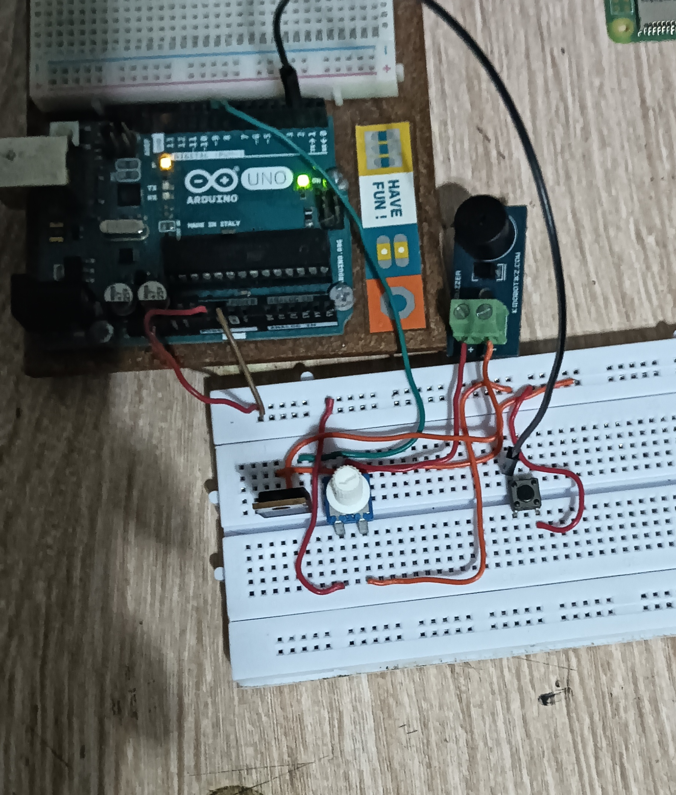
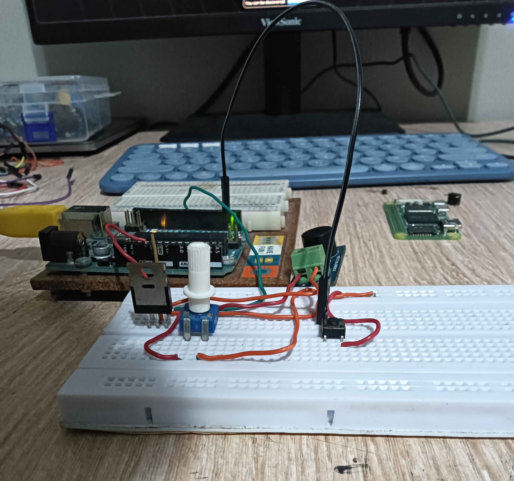

# Project Introduction
_Name_: Islamic Alarm <br>
_Description_: An alarm that fetches prayer times using an API, and rings accordingly. <br>
_Pronouns_: Beep/Boop


### Entry One: 
**November 15, Sunday** <br>
**1 hour 07 minutes**

This session's goal was simple: Get the audio part to work. I decided to tackle this step by step due to this condition I have, called being a beginner in hardware. My first goal, stage one, was to be able to use the parts below, namely a mosfet, potentiometer and buzzer to work along with a switch. I have discovered this magical thing called digital pins, to which I will now declare my never ending love to. Using the pins 2, and 8 for the button and speaker respectively, I created a simple code in ```void loop()``` where the button pin is checked for a LOW signal. When declaring the pin modes in ```setup()```, I made sure to use ```INPUT_PULLUP``` so I can ommit the resistor part. <br>

Linking the potentiometer to the speaker will let me adjust the volume; I plan to keep this accessible outside the case for the final product. As for the switch, right now it simply makes the speaker play when pressed. I saw an example code online where they use a boolean value to make the speaker sound stop, so I'm looking forward to implementing that. <br>

ALSO! I'm using a buzzer with a screw terminal block right now, since the final 0.8W speaker I intend to use requires soldering. I do think I'll be using simple beeps to make a melody rather than music, cause I'm trying to keep it halal.
_Emits aura_ 
<br>Maybe I'll implement an athan option too. Haha, I hope they give this to a muslim reviewer so the poor non-muslim one doesn't start looking like <a href=https://cdn.hackclub.com/01a096d3-102b-7840-a555-0ccfd54fe699/journal-1789236809140.png> this </a>

I'm also substituting the Raspberry Zero 2W I'm planning to use (Wifi will be required to fetch data from the API, I think?) for an Arduino Uno for the first few stages (or levels like I like to call it, makes it fun!) since it already has the soldered pins (yes, I'm afraid to solder the raspberry's pins yet). Anyhow, that's Level One done! <br>

Love, <br>
Meeran

<h4>Materials used in this session: </h4>
<ul>
    <li>Full sized breadboard </li>
    <li>Arduino Uno </li>
    <li>Buzzer</li>
    <li>Potentiometer</li>
    <li> IRF520 N-Channel Mosfet (Lowkey learning what that even means as we go)</li>
    <li>Switch</li>
    <li>Jumper Wires</li>
</ul>

<h4>Images</h4>


<a href="https://user-cdn.hackclub-assets.com/01a1dfd2-f48a-7acb-b6b7-a78cb2a4559a/paste-1794756505917.png">Schematics</a>

